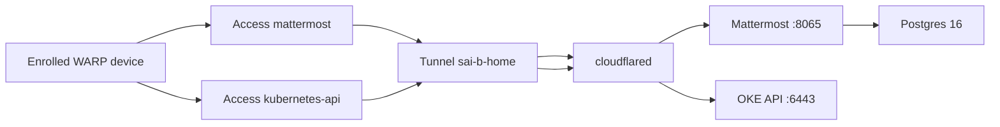
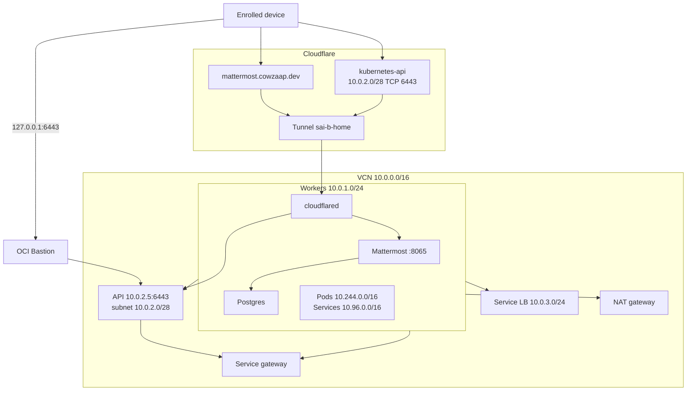

# sai-b-home-infra

Private Oracle Kubernetes Engine cluster for Mattermost, reached only by devices enrolled in the `cowzaap` Cloudflare Zero Trust organization.

Two Terraform roots keep Oracle and Cloudflare credentials apart. Kubernetes releases live under `k8s/` and are installed with Helm.

## Layout

| Path | What it owns |
| --- | --- |
| `terraform/` | VCN, private OKE cluster, two worker nodes, NAT, bastion |
| `cloudflare/` | Tunnel `sai-b-home`, WARP device settings, Access, public DNS |
| `k8s/platform` | Storage class, Postgres, `cloudflared` |
| `k8s/` | Mattermost Helm values and `make connect` |
| `.sops.yaml` | PGP recipient for encrypted secrets |

Plaintext `terraform.tfvars`, state, `k8s/secrets.yaml`, `k8s/mattermost-values.yaml`, and `k8s/generated/` are gitignored. Commit only the SOPS `.enc` siblings.

## Prerequisites

- Terraform `>= 1.6` (OCI provider `~> 9.13`, Cloudflare provider `~> 5`)
- OCI CLI, with a profile in `~/.oci/config`. `k8s/Makefile` defaults that profile to `sai-b-home-agent`.
- Helm 3, `kubectl`, OpenSSH, Python 3, and `lsof`
- [SOPS](https://github.com/getsops/sops) and the admin GPG key `ED7833DEE149B3BAFDB01329ECE724055939E0C0`
- An enrolled Cloudflare One client for team `cowzaap`. Consumer WARP does not pass the Access posture check.
- A Cloudflare API token that can manage tunnels, Zero Trust (device settings and Access), and DNS in zone `cowzaap.dev`

The cluster API is private. `kubectl` reaches it through an OCI Bastion port-forward, so the bastion allow list has to include the IPv4 address Oracle sees while WARP is connected.

## Components



Browsers use `https://mattermost.cowzaap.dev`. That hostname is its own Access application. The policy allows a device only when it is enrolled in this Zero Trust org. The tunnel origin is `mattermost-team-edition.mattermost.svc.cluster.local:8065`.

The Kubernetes API is a second Access application, `kubernetes-api`. Its destination is the API subnet `10.0.2.0/28` on TCP `6443`. The tunnel still publishes that route, and Access denies the port unless the kubernetes policy matches. The two policies both require enrollment today, and they are separate resources so a later service can be added to Mattermost without being added to the API. Worker and load-balancer routes are not part of either application.



| Range | Use |
| --- | --- |
| `10.0.0.0/16` | VCN `sai-b-home-vcn`. Every subnet is private. |
| `10.0.0.0/24` | Not allocated. Left out of WARP so a home LAN in this range stays on the local network. |
| `10.0.1.0/24` | Worker nodes. Published on the tunnel. Any enrolled device can reach it. The security list allows the VCN and the pod overlay in. |
| `10.0.2.0/28` | OKE API subnet. The endpoint is `10.0.2.5:6443`. Published on the tunnel. The `kubernetes-api` Access application allows TCP `6443`. The security list accepts `6443` and webhook port `12250` only from the worker subnet. |
| `10.0.3.0/24` | Subnet for a private service load balancer. Published on the tunnel. Empty until a load balancer is created. |
| `10.244.0.0/16` | Flannel pod overlay. Stays inside the cluster and is not a tunnel route. |
| `10.96.0.0/16` | Kubernetes service network, including Postgres. Stays inside the cluster and is not a tunnel route. |
| `0.0.0.0/0` | Worker egress through the NAT gateway. |
| Oracle Services Network | API and worker traffic to Oracle services, through the service gateway. The route destination is `all-xsp-services-in-oracle-services-network`. |

The rest of `10.0.0.0/8` is excluded from WARP after `10.0.0.0/8` is removed from the device profile. The exact holes are `split_tunnel_exclude_add` in `cloudflare/outputs.tf`. Only `10.0.1.0/24`, `10.0.2.0/28`, and `10.0.3.0/24` from that space are sent into the tunnel.

| Piece | Choice |
| --- | --- |
| Region | `ap-singapore-2` |
| Cluster | Basic OKE, Kubernetes `v1.36.4`, Flannel |
| API | Private endpoint. Pods `10.244.0.0/16`, services `10.96.0.0/16` |
| Nodes | Two `VM.Standard.E4.Flex`, 1 OCPU and 8 GB each, 50 GB boot |
| Egress | `0.0.0.0/0` via the NAT gateway. Oracle services use the service gateway |
| WARP routes | `10.0.1.0/24`, `10.0.2.0/28`, `10.0.3.0/24` |
| API Access | Private application `kubernetes-api` for `10.0.2.0/28` TCP `6443` |
| Namespaces | `platform` for Postgres, `mattermost` for the app, `cloudflare` for two `cloudflared` replicas |
| Mail | Mattermost submits to `smtp.mx.cloudflare.net:465`. Email Sending for `cowzaap.dev` is configured in Cloudflare, outside these Terraform roots |

An enrolled device can open `10.0.2.5:6443` through WARP only when the `kubernetes-api` Access application allows it. `make connect` still publishes a bastion forward on `127.0.0.1:6443` and rewrites the local kubeconfig to that address. The API security list accepts 6443 from the worker subnet, which is where `cloudflared` and the bastion session originate.

`k8s/generated/` is local and stays untracked. `make connect` creates the bastion key if it is missing and rewrites a kubeconfig that calls the OCI CLI. The cluster kubeconfig, worker SSH key, database password, and tunnel token are the files under `terraform/generated/*.enc` and `cloudflare/generated/*.enc`.

## Prepare a workstation

Decrypt committed secrets before planning or installing. Encrypt needs the public key. Decrypt needs the GPG passphrase.

```sh
make decrypt-all
```

That restores, mode `600`:

- `terraform/terraform.tfvars` and `terraform/terraform.tfstate`
- `cloudflare/terraform.tfvars` and `cloudflare/terraform.tfstate`
- `terraform/generated/` kubeconfig, worker key, and database password
- `cloudflare/generated/tunnel_token`
- `k8s/secrets.yaml` and `k8s/mattermost-values.yaml`

On a new machine, copy the examples once and fill them in. Do not commit those plaintext files.

```sh
cp terraform/terraform.tfvars.example terraform/terraform.tfvars
cp cloudflare/terraform.tfvars.example cloudflare/terraform.tfvars
```

`bastion_client_cidrs` must include the workstation address Oracle sees. With WARP connected, that is the WARP egress address, not the home ISP address.

Initialize each root from its own directory:

```sh
make -C terraform init
make -C cloudflare init
```

## Provision

Apply Oracle first. The Cloudflare routes copy the worker, API, and load-balancer CIDRs from `terraform/locals.tf`; they are not remote state.

```sh
make -C terraform plan
make -C terraform apply
make -C cloudflare plan
make -C cloudflare apply
```

Connect WARP, then open the bastion session and install the charts. The platform chart has to exist before Mattermost: it creates the namespaces, the storage class, and Postgres.

```sh
make -C k8s connect
make -C k8s platform
make -C k8s mattermost
```

`make connect` prints the `KUBECONFIG` path. The OCI profile is already written into that kubeconfig. The bastion session lives for 3 hours. Run `make connect` again after it expires. An existing forward on `127.0.0.1:6443` is reused.

`make -C k8s apply` runs platform and then Mattermost.

After changing a secret, encrypt it back and remove the plaintext copy:

```sh
make encrypt-all
make cleanup
```

`cleanup` deletes a plaintext file only when its `.enc` sibling is already there.

## Mattermost

Helm release `mattermost` uses the upstream `mattermost/mattermost-team-edition` chart and `k8s/mattermost-values.yaml`. Postgres is `postgres.platform.svc.cluster.local`. The site URL is `https://mattermost.cowzaap.dev`. The pod runs as UID 2000 with `fsGroup: 2000` so the block volumes are writable.

SMTP is in that values file: host `smtp.mx.cloudflare.net`, port `465`, username `api_token`, from `mattermost@cowzaap.dev`. The password is a Cloudflare API token and is encrypted by SOPS. Re-encrypt after editing the plaintext file, then `make -C k8s mattermost`.
